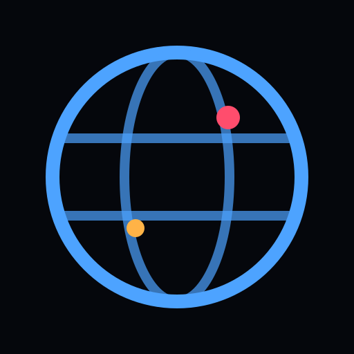
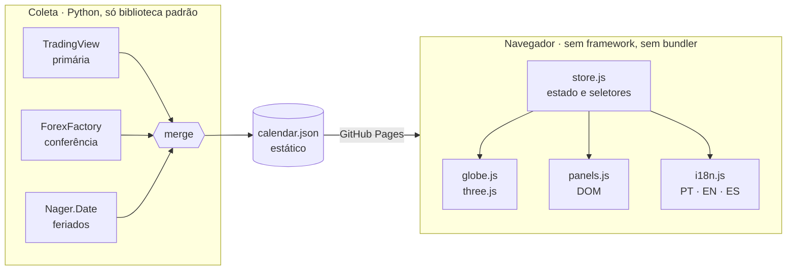
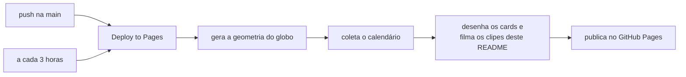

<div align="center">



# orbis

### O mundo inteiro mexe no mercado. Agora você vê de onde.

Cada indicador, cada decisão de banco central e cada feriado de mercado do planeta,<br>
num globo 3D iluminado pela posição real do sol. **Grátis, sem cadastro, sem chave de API.**

<br>

<a href="https://th3usbit.github.io/orbis/"></a>

<br><br>

<a href="https://th3usbit.github.io/orbis/"></a>
<a href="https://th3usbit.github.io/orbis/"></a>
<a href="https://th3usbit.github.io/orbis/"></a>
<a href="https://github.com/Th3usBit/orbis/actions/workflows/ci.yml"></a>
<a href="LICENSE"></a>

</div>

<br>

<p align="center">
  <a href="https://th3usbit.github.io/orbis/">
    
  </a>
</p>

<p align="center"><sub>
  Isto não é um vídeo de divulgação. É o site real, filmado sozinho pelo robô de deploy com o calendário de hoje,<br>
  e refilmado a cada nova coleta. O lado escuro do planeta é onde é noite agora.
</sub></p>

<br>

<p align="center">
  
</p>

<p align="center"><sub>Ninguém digitou esses números. Eles saem do mesmo arquivo que o site lê, na mesma hora.</sub></p>

---

## Você já perdeu um movimento por olhar a planilha errada

Calendário econômico, do jeito que todo mundo conhece, é uma parede de linhas em ordem de horário. Ele te diz **o quê** e **quando**. E esconde as duas perguntas que importam de verdade:

> **Onde** o dinheiro está se mexendo agora?<br>
> **Quem** está acordado para reagir?

Você percebe que Tóquio estava aberto só depois do candle. Descobre o feriado em Nova York quando a liquidez some. Abre três abas, converte fuso de cabeça e torce para não ter pulado nenhuma linha.

**O orbis tira a planilha da frente e põe o planeta no lugar.**

---

## Bata o olho, entenda o dia


Cada país com agenda no dia ganha um **pilar**. A altura e a cor dizem o peso: <kbd>🔴 alto</kbd> <kbd>🟠 médio</kbd> <kbd>🔵 baixo</kbd> <kbd>🟣 feriado</kbd>.

O cartão **"Próximo evento de alto impacto"** faz a contagem regressiva ao segundo. Um clique e a câmera **voa até o país**. Mais um clique e o evento abre com **efetivo, projeção e anterior** lado a lado, mais o quanto o número veio acima ou abaixo do esperado e o link direto para a instituição que publicou.

E o terminador entre dia e noite **não é enfeite**: ele é calculado a partir do ponto subsolar real, com a correção da equação do tempo. Você vê na hora quem está operando e quem está dormindo.

---

## A semana inteira, antes de ela começar


A faixa inferior mostra **quatro semanas de agenda** em miniatura, cada dia empilhado por impacto. Uma semana pesada aparece antes de você clicar nela. Dá para navegar pelas setas <kbd>←</kbd> <kbd>→</kbd>, pelo mouse ou pelo toque, e o sol acompanha: troque de dia e o terminador **varre o globo**.


<sub>A janela real desta coleta. O dia contornado em azul é hoje, e ele anda sozinho.</sub>

---

## Só o que mexe com a sua posição


Dois mil eventos é muito. Três cliques e sobram **só os de alto impacto**. Filtre por **região** ou por **categoria** (inflação, juros, emprego, atividade…) e o globo, a lista e a linha do tempo obedecem juntos. Cada contador se refaz na hora, para você nunca adivinhar quanto ficou de fora.

---

## Onde o mundo está falando nesta janela


<sub>Os dois quadros acima são redesenhados a cada coleta. Se a semana for de bancos centrais, você vai ver isso aqui antes de ler uma linha.</sub>

---

## Por que confiar no que aparece na tela

**Duas fontes que concordam valem mais que uma.** O orbis não empilha feeds, ele **reconcilia** os dois. Duas linhas só viram o mesmo evento quando batem o país, o horário (até 45 minutos de diferença) e o título, com travas para os casos em que a semelhança de texto engana:

| Parece igual | Mas não é | A trava |
|---|---|---|
| `CPI MoM` e `CPI YoY` | variação mensal e anual | o período tem que bater |
| `Exports` e `Imports` | direções opostas | a polaridade não pode inverter |
| índice em ~330 e variação de ~0,4 | escalas diferentes | a ordem de grandeza tem que fazer sentido |

O que passa leva a marca **✦ confirmado**. Ela é rara de propósito: só aparece quando duas fontes independentes dizem a mesma coisa.

**E quando uma fonte cai, você fica sabendo.** O painel de fontes mostra cada uma com o status e o motivo da falha. Se a fonte principal falhar, o deploy **se recusa a publicar** um calendário pela metade. Um calendário um pouco mais velho, mas honesto, é melhor que um atualizado faltando dezenove de cada vinte eventos.

---

## Fala a sua língua. Até o nome do indicador.


Português, English e Español: não só os botões, mas **cada nome de indicador e cada país**. O orbis traduz frase por frase os títulos que chegam dos feeds em inglês. Escolhe o idioma do seu navegador na primeira visita e lembra da sua troca depois.

Tudo em **UTC**, porque esse é o único horário honesto para um calendário que cobre todos os mercados. O relógio do topo mostra quanto o seu fuso está longe dele.

---

## Cabe no bolso

<table>
<tr>
<td width="38%" align="center">

</td>
<td>

**No celular, o globo ocupa a tela toda** e os filtros voltam por um botão, sem sacrificar nada.

**Instale como app.** Tudo o que a página precisa já está no próprio site.

**Mande uma visão para alguém.** O endereço acompanha o dia e o país que você está vendo:

```
th3usbit.github.io/orbis/?d=2026-11-05&c=US
```

**Leve para a sua ferramenta.** O que estiver no painel sai em **`.csv`** para a planilha ou em **`.ics`** para a sua agenda, gerado no seu navegador e salvo direto no seu disco. Nada é enviado a lugar nenhum.

</td>
</tr>
</table>

---

## Funciona até no avião

O three.js e as fontes vêm **dentro do repositório**. A página não chama nenhum CDN, não carrega script de terceiros e não tem rastreador. **Nenhuma requisição do seu navegador sai do próprio site**, e um teste automatizado garante isso a cada mudança.

Clonou, gerou os dados uma vez, e o globo roda sem internet:

```bash
./start.sh offline      # Linux / macOS
start.bat offline       # Windows
```

---

## Como funciona por dentro


<sub>Os volumes do diagrama são os desta coleta. As partículas saem de cada fonte na proporção do que ela entregou.</sub>

A restrição que define a arquitetura inteira: **nenhum feed gratuito libera CORS**, então o navegador não pode chamá-los. Em vez de pagar um servidor para servir de ponte, o orbis transformou isso em vantagem:

1. **Coleta.** Um script Python, só com a biblioteca padrão, busca as três fontes. Cada fonte é um módulo isolado: se uma cair, as outras seguem e a falha fica registrada.
2. **Normalização.** Cada provedor fala de um jeito. Tudo vira um esquema só, inclusive números como `3.2%`, `-1.4K`, `215B` e `1.234,5`, que são a mesma ideia em convenções diferentes.
3. **Reconciliação.** As fontes são cruzadas e as concordâncias ganham o ✦.
4. **Publicação.** Sai **um único arquivo estático**, que o GitHub Pages serve de graça. O navegador lê esse arquivo e mais nada.

Sem backend para manter de pé. Sem chave para vazar. Sem conta para pagar.



### Um robô cuida de tudo



A cada rodada, o site inteiro é reconstruído do zero e **nada é commitado de volta**. O repositório só guarda código: nenhum clone herda o calendário velho de outra pessoa.

---

## Feito com

| | Ferramenta | Por que essa |
|---|---|---|
| 🌍 | **[three.js](https://threejs.org/)**, empacotado no repositório | Globo em WebGL com shaders próprios: oceano iluminado pelo sol, matriz de pontos de área igual, atmosfera aditiva |
| 🧠 | **JavaScript puro**, módulos ES | Uma tela, um *store* com `subscribe`. Sem framework e sem build: o que está no repositório é exatamente o que roda |
| 🐍 | **Python 3.9+**, só biblioteca padrão | O coletor inteiro sem nenhum `pip install` |
| ⚙️ | **GitHub Actions** | CI em Linux, Windows e macOS, mais o deploy agendado |
| 🚀 | **GitHub Pages** | Hospedagem estática de graça, para sempre |
| 🎭 | **Playwright** | Testa a página num navegador real e filma os clipes deste README |
| 🎞️ | **ffmpeg** | Transforma os quadros filmados em WebP animado |
| 🗺️ | **[Natural Earth](https://www.naturalearthdata.com/)** | Litorais e fronteiras em domínio público |
| 🔤 | **Inter** e **JetBrains Mono** | Também empacotadas, para não depender de nenhum serviço de fontes |

**As fontes de dados**, todas gratuitas, sem chave e sem conta:

| Fonte | Papel | Cobertura |
|---|---|---|
| [TradingView](https://www.tradingview.com/economic-calendar/) | principal | ~80 países, com impacto, efetivo, projeção e anterior |
| [ForexFactory](https://www.forexfactory.com/calendar), via feed da FairEconomy | conferência cruzada | principais moedas |
| [Nager.Date](https://date.nager.at) | contexto | feriados públicos no mundo todo |

<details>
<summary><b>E as fontes que ficaram de fora?</b></summary>

<br>

- **Trading Economics**: a conta `guest:guest` responde `410 Gone`, e a API agora é só paga.
- **MQL5**: não tem API pública, só um endpoint interno sem termos de uso para terceiros.
- **FRED**: tem dados oficiais, mas exige chave e publica só a data, sem horário. Seria um passo atrás em todos os campos que o orbis mostra.

</details>

---

## O orbis lado a lado

| | Calendário em lista | **orbis** |
|---|:---:|:---:|
| O quê e quando | ✅ | ✅ |
| **Onde**, num relance | você imagina | ✅ no globo |
| **Quem está acordado** agora | você calcula o fuso | ✅ terminador real |
| A semana inteira antes de começar | rolando a página | ✅ linha do tempo |
| O que duas fontes confirmaram | — | ✅ ✦ |
| Cadastro ou chave de API | depende do site | **nunca** |
| Requisições a terceiros | depende do site | **zero** |
| Funciona offline | — | ✅ |
| Código aberto para você auditar | — | ✅ MIT |

---

## Comece em 30 segundos

```bash
git clone https://github.com/Th3usBit/orbis.git
cd orbis
./start.sh        # no Windows: start.bat
```

Só isso. O `start` encontra o Python, gera a geometria do globo na primeira vez, coleta o calendário mais recente e abre `http://127.0.0.1:8080`.

**O único requisito é o Python 3.9+.** Nada de `npm install`, `package.json` ou ferramenta de build. O Node só entra se você quiser rodar os testes.

> [!NOTE]
> A primeira execução precisa de internet e leva cerca de um minuto, porque o repositório não traz dado nenhum: tudo é gerado na sua máquina a partir das fontes públicas. Depois disso, é instantâneo.

<details>
<summary><b>Ajustes</b></summary>

<br>

**Janela de tempo**: o padrão é 7 dias para trás e 21 para frente.

```bash
python scripts/fetch.py --days-back 14 --days-ahead 45
```

**Densidade do globo**: mude `DOT_SPACING_DEG` em `scripts/build_geometry.py`, apague `assets/land-dots.json` e rode de novo.

**Cores de impacto**: `IMPACT_COLORS` em `js/store.js`, espelhadas em `--impact-*` no `css/orbis.css`. Mude nos dois lugares.

**Frequência do robô**: o bloco `schedule:` em `.github/workflows/pages.yml`.

**Clipes do README**: `python scripts/readme_cards.py` desenha os cards; `node scripts/readme_media.mjs` filma os clipes (precisa de Playwright e ffmpeg).

</details>

---

## Tenha o seu, em dois cliques

1. Faça um **fork**.
2. Rode o workflow **Deploy to Pages**, ou faça qualquer push.

O primeiro deploy liga o GitHub Pages sozinho. O seu fork gera a própria geometria, coleta o próprio calendário e publica no seu `github.io`. **Nenhum segredo para configurar, nenhuma chave de API, nenhuma conta em provedor de dados.**

> [!TIP]
> O GitHub desativa workflows agendados em repositórios públicos depois de 60 dias sem atividade. Se o seu calendário parar de andar, reative em **Actions**, ou com `gh workflow enable "Deploy to Pages"`. O site avisa quando os dados ficam velhos, em vez de envelhecer em silêncio.

---

## Qualidade que dá para verificar

Oito suítes de teste rodam a cada mudança, **contra os dados que os feeds publicaram no dia**, não contra um arquivo de exemplo:

```bash
node tests/store.test.mjs .     # estado e todos os seletores
node tests/format.test.mjs .    # formatação de números, URLs seguras, astronomia
node tests/export.test.mjs .    # os .ics e .csv que o painel entrega
node tests/url.test.mjs .       # a visão que viaja no endereço
node tests/i18n.test.mjs .      # paridade PT/EN/ES contra títulos reais
node tests/merge.test.mjs .     # o formato do dado reconciliado
node tests/offline.test.mjs .   # nada busca CDN
node tests/ui.test.mjs .        # a página real num navegador real (Playwright)
```

A suíte de interface mede **contraste em pixels renderizados**, não em cores declaradas. Ela também confere se dá para chegar a tudo pelo teclado e se o layout aguenta quatro larguras de tela. O CI constrói tudo do zero em **Linux, Windows e macOS**, mais um job no Python 3.9.

---

## Perguntas que todo mundo faz

<details>
<summary><b>É grátis mesmo? Qual é a pegadinha?</b></summary>
<br>
Não tem pegadinha. O orbis só usa fontes públicas que não exigem chave, roda num site estático e não tem servidor. Não existe custo para repassar a ninguém.
</details>

<details>
<summary><b>Com que frequência os dados atualizam?</b></summary>
<br>
O robô está agendado a cada 3 horas, e o GitHub costuma entregar umas quatro rodadas por dia. A janela cobre três semanas à frente, então perder uma rodada não deixa buraco. O horário exato da última coleta aparece no site e no badge lá em cima.
</details>

<details>
<summary><b>Posso operar com base nisso?</b></summary>
<br>
O orbis é uma ferramenta informativa e educacional, <b>não é recomendação de investimento</b>. Números são revisados, feeds erram e horários mudam. Cada evento tem o link para a instituição que o publicou, justamente para você confirmar na fonte antes de qualquer decisão.
</details>

<details>
<summary><b>Por que os horários estão em UTC?</b></summary>
<br>
Porque é o único horário que não favorece nenhum mercado. Os dias são agrupados no seu fuso, como você lê um calendário. O relógio do topo mostra a diferença entre o seu horário e o UTC.
</details>

<details>
<summary><b>Os dados ficam guardados no repositório?</b></summary>
<br>
Não. O repositório só tem código. O calendário é coletado na hora, por você ou pelo robô de deploy, e cada provedor mantém os direitos sobre o próprio feed. Detalhes em <a href="NOTICE.md">NOTICE.md</a>.
</details>

---

## Contribua

Issues e pull requests são bem-vindos. Os detalhes estão no [`CONTRIBUTING.md`](CONTRIBUTING.md). Em resumo:

- **Só fontes gratuitas e sem chave.** Essa restrição é o projeto.
- **Sem dependências.** Python padrão e JavaScript puro. Se precisar de `pip install` ou `package.json`, a promessa quebrou.
- **Comentários explicam o porquê, com o que foi medido.**

Para adicionar um idioma são quatro edições: um bloco em `UI` e uma tabela em `PHRASES` no `js/i18n.js`, uma coluna `name_xx` no `data/countries.json` e um botão com a bandeira no `index.html`. O teste de i18n cuida do resto.

**Vem aí:** calendários de reuniões de bancos centrais buscados direto das instituições (os feeds param em ~33 dias, os bancos publicam com anos de antecedência) e mais idiomas.

---

## Licença

[MIT](LICENSE) para o código. O que está em [`vendor/`](vendor/) mantém a própria licença (three.js é MIT; Inter e JetBrains Mono são SIL OFL 1.1). O [`NOTICE.md`](NOTICE.md) tem a prestação de contas completa.

O orbis não distribui dado nenhum: o calendário é buscado em tempo de execução nas fontes listadas acima, e cada provedor mantém os direitos sobre o próprio feed.

<br>

<div align="center">

### O mercado não para de girar. Agora você acompanha.

<a href="https://th3usbit.github.io/orbis/"></a>

<sub>Se o orbis te poupou uma aba, deixe uma ⭐: é assim que mais gente encontra.</sub>

</div>
