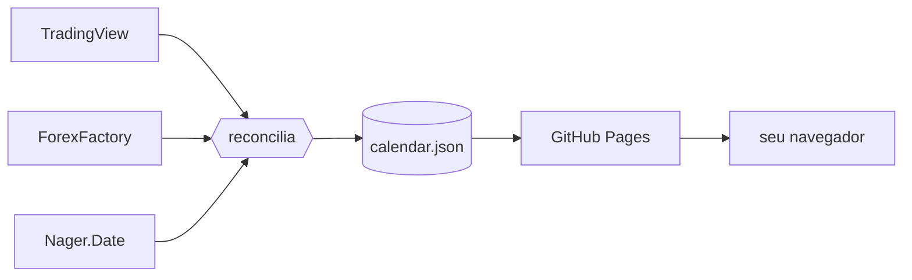

<div align="center">

# orbis

**O calendário econômico do mundo, onde ele acontece.**

Indicadores, decisões de bancos centrais e feriados de mais de 70 países<br>
num globo 3D interativo. Grátis e sem cadastro.

[**Abrir o orbis**](https://th3usbit.github.io/orbis/) · [Como funciona](#como-funciona) · [Rodar localmente](#rodar-localmente)

<br>

<a href="https://th3usbit.github.io/orbis/"></a>

</div>

## Por que um globo

Um calendário econômico comum é uma lista em ordem de horário. Ele diz o quê e quando, mas não diz **onde**. No orbis você vê isso num relance:

- **Onde a agenda está.** Cada país com evento no dia ganha um pilar, com altura e cor pelo impacto.
- **O que já saiu.** Efetivo, projeção e anterior lado a lado, com quanto o número veio acima ou abaixo.
- **O que vem pela frente.** Quatro semanas de agenda numa faixa, antes de você clicar em qualquer coisa.

## Recursos

### O evento que importa, a um clique

O cartão do próximo evento de alto impacto faz a contagem regressiva. Um clique leva a câmera até o país; outro abre o efetivo, a projeção e o anterior.


### Quatro semanas numa faixa

Cada dia aparece empilhado por impacto, então uma semana pesada salta aos olhos. Troque de dia e os pilares acompanham.


### Só o que mexe com você

Filtre por impacto, região ou categoria. O globo, a lista e as contagens se atualizam juntos.


### Em três idiomas e no celular

<table>
<tr>
<td width="50%" align="center"></td>
<td width="50%" align="center"></td>
</tr>
<tr>
<td align="center">Português, inglês e espanhol, com os principais indicadores traduzidos.</td>
<td align="center">No celular, o globo ocupa a tela e os filtros abrem por um botão.</td>
</tr>
</table>

Também dá para exportar o que está na tela em `.csv` ou `.ics`, mandar um link que abre no mesmo dia e país (`?d=2026-11-05&c=US`) e instalar o site como app.

## Como funciona

Nenhum feed gratuito de calendário libera acesso direto pelo navegador. Por isso, um coletor em Python roda fora dele, cruza as fontes e grava **um único arquivo estático**. O site só lê esse arquivo.



Eventos que duas fontes independentes confirmam ganham a marca ✦ na lista. Um robô do GitHub Actions refaz tudo a cada 3 horas, inclusive os vídeos deste README, gravados do site real. Não há servidor nem chave de API: o `calendar.json` vai direto para o GitHub Pages, sem commit no repositório.

## Rodar localmente

```bash
git clone https://github.com/Th3usBit/orbis.git
cd orbis
./start.sh        # no Windows: start.bat
```

O único requisito é o Python 3.9+, sem `pip install`. A primeira execução baixa os dados públicos e abre `http://127.0.0.1:8080`. Depois disso, `./start.sh offline` funciona sem internet.

## Dados e privacidade

As fontes são [TradingView](https://www.tradingview.com/economic-calendar/), [ForexFactory](https://www.forexfactory.com/calendar) e [Nager.Date](https://date.nager.at): todas públicas e sem chave. O three.js e as fontes tipográficas vêm dentro do repositório, então a página não faz nenhuma requisição a terceiros e não tem rastreador.

O orbis é informativo e **não é recomendação de investimento**. Cada evento tem o link da instituição que o publicou.

## Licença

[MIT](LICENSE). Contribuições são bem-vindas; veja o [`CONTRIBUTING.md`](CONTRIBUTING.md).
